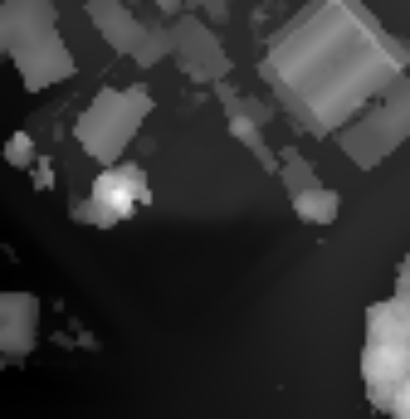
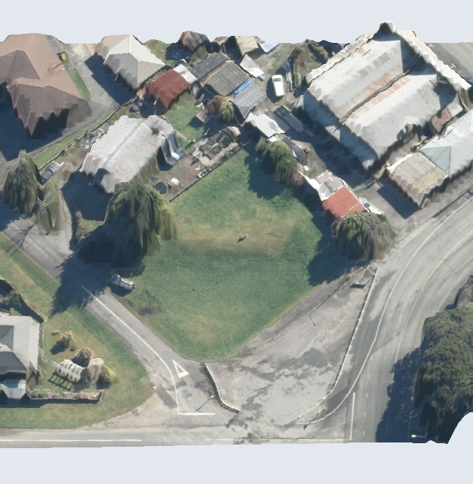
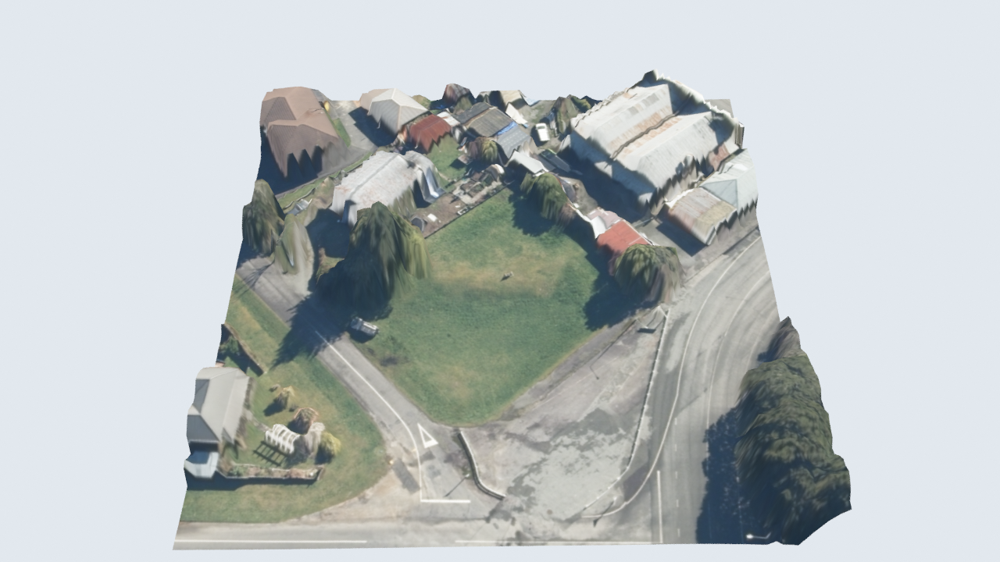

# Relief views: how soon each is ready (#149)

The demo site, 35 Victory Street, Reefton; code 54ad6d5. Reading its DEM, DSM and aerial
from LINZ took 5.2 s, before any tier ran; a built site in the app
has them on disk. **Ready after** counts from when the tiers start, so it
is how long an owner waits for each view.

| Tier | Status | Ready after (s) | Took (s) |
|---|---|---|---|
| depth | ready | 0.08 | 0.08 |
| parallax | ready | 2.09 | 2.01 |
| flyover | ready | 9.84 | 7.75 |

